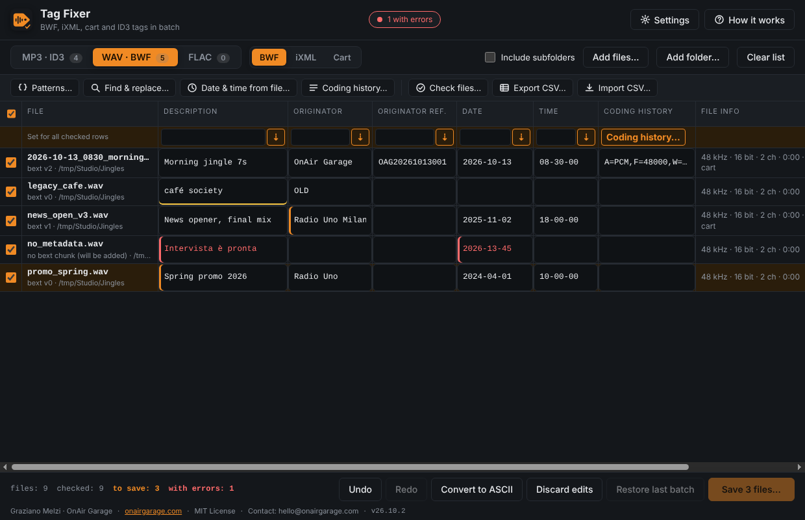

# Tag Fixer (BWF, iXML, cart and ID3 tag fixer)

Read and correct audio metadata in batch: **ID3 tags and cover pictures on MP3** (ID3v2.2, v2.3, v2.4), **BWF `bext` with its CodingHistory, iXML and cart (AES46) on WAV and BWF, also RF64/BW64**, and **Vorbis comments on FLAC**. Spreadsheet-style table with patterns, find & replace, dates from the file, CSV in and out, consistency checks and undo; every file is backed up before it is touched, with one-step restore. Free desktop app (Electron) from [OnAir Garage](https://onairgarage.com).



- Tool page: https://onairgarage.com/tools/tag-fixer/
- Author: Graziano Melzi · OnAir Garage — hello@onairgarage.com
- License: MIT (see `LICENSE`)
- Systems: Windows (installer), macOS (dmg, Apple silicon and Intel), Linux (AppImage, x64). The tests of this release ran on **Linux** (and the end-to-end scripts on Linux under Xvfb); Windows and macOS were not run for this release (see "Not validated").

More screenshots: [`mp3-cover.png`](docs/screenshots/mp3-cover.png), [`patterns.png`](docs/screenshots/patterns.png), [`cart-check.png`](docs/screenshots/cart-check.png).

## What it does

Drop audio files or folders on the window. MP3, WAV and FLAC files go to their own tab; WAV has three views (BWF, iXML, Cart). Click a cell and type; edited cells are highlighted, invalid ones turn red. The highlighted row under the headings writes one value into every checked row. "Save…" shows the list of changes, the backup folder and the free space, then edits the files. Every tool changes the table only; nothing is written to a file until you save.

- **MP3 (ID3v2.2 / v2.3 / v2.4):** title, artist, album, year, track, genre, comment and the **cover picture** (JPEG or PNG: put it as the front cover in one or many files, or remove it). Everything else in the tag (private frames, unknown frames, other pictures) is copied byte for byte. The tag version is kept (year is `TYE`, `TYER` or `TDRC`); a file without an ID3v2 tag gets a v2.3 tag; an ID3v1 tag is shown when there is no v2 tag and is never modified. The genre box suggests the ID3v1 / Winamp names; any text is accepted.
- **WAV / BWF:** the five editable `bext` fields and the **CodingHistory** (edit it in one file, or replace it or add a line in all checked files); the **iXML** elements PROJECT, SCENE, TAPE, TAKE and NOTE (the rest of the XML is kept character for character; a file without iXML gets a new chunk); the **cart** fields title, artist, cut ID, client ID, category, classification, out cue, start and end date and time, user defined (the rest of the 2048-byte fixed part and the tag text are kept). `TimeReference`, `UMID`, loudness values and `Version` are shown or kept untouched. A WAV without `bext` / `cart` / `iXML` gets a new chunk when you edit it.
- **RF64 and BW64** (files over 4 GB, with a `ds64` chunk): read and edited like any other WAV. A change that keeps the size is written in place; the others rewrite the file and keep `ds64` consistent.
- **FLAC:** title, artist, album, date, track number, genre and comment (Vorbis comments). Other comments and the other metadata blocks are kept; the free space (padding) is used first, so most edits do not move the audio.
- **Patterns:** fill a field from a pattern (`{artist} - {title}`, `{n:3}`, `{filename|lower}`…), read fields out of the file name, or **rename files** from their tags; patterns can be saved and travel with the configuration backup.
- **Find & replace and clean-ups** on one field or on all fields of the view: plain text or regular expression, whole word, case; trim, collapse spaces, UPPER / lower / Title / Sentence case, remove accents, ASCII.
- **Date & time from the file:** BWF origination date and time, or cart start / end, from the file name (`2026-10-13_0830…`) or from the modification or creation time.
- **CSV:** export the table (or the checked rows) and import it back; rows are matched by full path or by a unique file name; an empty cell leaves the field alone unless you choose to clear it.
- **Check files:** missing fields, invalid values, dates in the future, duplicates, damaged files, with a filter to see only those files.
- **Undo / redo** (Ctrl+Z, Ctrl+Y) for every edit and every tool.
- **Safety:** original copied (with its modification time) to the backup folder before any change; changes that keep the file size are patched in place; others go through a temporary file that replaces the original only when complete and verified; every file is read back and compared; on any problem the original is put back. **"Restore last batch"** restores the files of the last batch (not those edited again since), including names changed by a rename. A rename is the last step for each file and is refused beforehand if the name already exists, is invalid or would be given twice.
- Non-ASCII text in `bext` / cart fields is flagged (the specification is ASCII); "Convert to ASCII" turns `è` into `e` and shows the result before saving.
- Languages: English (default, the app always opens in English), Italiano, Español; theme: light, dark or follow the system. Settings, saved patterns and the language are kept in `settings.json`.
- **Guided update** (Settings → Updates, and a banner): when a new release is out, *Download and install* (progress bar, Cancel), the file is checked against the release's `SHA256SUMS.txt`, *Close and install* saves a safety copy of the settings first; *Remind me later* (24 hours) and *Skip this version*; a *What's new* window after the update. Nothing is downloaded or installed without a click; the check can be switched off.
- **Help & About** with credits, links, *Copy info for support* (no file names or settings) and *Open logs folder*; daily logs (at most 5 MB each, 7 days by default; no file names).
- **Configuration backup** (Settings → Backup): export and import the settings and the saved patterns (`tag-fixer-backup-YYYY-MM-DD.json`); this app keeps no passwords or tokens, so there is no password box and nothing secret in the file.

## Formulas and sources

No measurements. The rules come from these documents; "status" says how far each was checked.

| Value / rule | Source | Status |
|---|---|---|
| `bext` layout: Description 256, Originator 32, OriginatorReference 32, OriginationDate 10, OriginationTime 8, TimeReference 8, Version 2, UMID 64, loudness 10, Reserved 180, CodingHistory variable (fixed part 602 bytes) | EBU Tech 3285 v2.0 (May 2011), clause 2.3 | **official** (read, release 26.10.1) |
| Text fields are ASCII; shorter strings end with a NUL; date `yyyy-mm-dd`, time `hh-mm-ss`, any separator; ranges | same | **official** (read, release 26.10.1) |
| Version 0: 254 reserved bytes after Version; Version 1: UMID; Version 2: loudness; unknown chunks must be passed on | same, clauses 1.1 and 2.1 | **official** (read, release 26.10.1) |
| Inserting a new `bext` / `cart` / `iXML` chunk after `fmt ` (after `bext` when there is one) | the specification does not demand an order; before the audio is what older readers handle best | **recommended** (my choice) |
| CodingHistory: ASCII, one line per step, each line ends with CR LF; the window edits it as plain lines | EBU Tech 3285 v2.0 (ASCII, CR LF). The syntax of the lines (`A=PCM,F=48000,…`) is EBU R 98: **not read**, so the text of the lines is not checked | **official** for the container, **not read** for the syntax |
| RF64 / BW64: first chunk after `WAVE` is `ds64` (riffSize, dataSize, sampleCount as 64 bit, table of chunks over 4 GB); a size of `0xFFFFFFFF` in a chunk header means "see ds64" | read in an independent implementation, FFmpeg `libavformat/wavdec.c`. The text of EBU Tech 3306 / ITU-R BS.2088 could not be read (the PDF was not machine readable) | **read in an implementation**, specification text **not read** |
| cart chunk: Version[4] Title[64] Artist[64] CutID[64] ClientID[64] Category[64] Classification[64] OutCue[64] StartDate[10] StartTime[8] EndDate[10] EndTime[8] ProducerAppID[64] ProducerAppVersion[64] UserDef[64] LevelReference(int32) PostTimer[8 × (usage[4], int32)] Reserved[276] URL[1024] TagText; fixed part 2048 bytes | libsndfile `include/sndfile.h` (`SF_CART_INFO`), read. AES46-2002 itself **not read** | **read in an implementation**, specification text **not read** |
| cart dates `yyyy/mm/dd`, times `hh:mm:ss`, version `0101` for a new chunk | my understanding of AES46; the date and time layout of a real file was not checked against the standard | **not read** (Dati insufficienti per verificare) |
| iXML: root `BWFXML`, top-level elements `IXML_VERSION`, `PROJECT`, `SCENE`, `TAPE`, `TAKE`, `NOTE`, UTF-8 text; `1.5` for a new chunk | the specification site (ixml.info) could not be reached. Based on common practice | **not read** (Dati insufficienti per verificare) |
| FLAC: `fLaC`, metadata block header (last flag, 7-bit type, 24-bit length), types 0 STREAMINFO, 1 PADDING, 4 VORBIS_COMMENT, 6 PICTURE; Vorbis comment = vendor and `NAME=value` entries, 32-bit little-endian lengths; field names case-insensitive | RFC 9639 (FLAC), read | **official** (read) |
| Vorbis field names for the columns: TITLE, ARTIST, ALBUM, DATE, TRACKNUMBER, GENRE, COMMENT | common use, as written by FFmpeg and most taggers | **recommended** |
| ID3v2.2: 3-character frame ids (`TT2 TP1 TAL TYE TRK TCO COM PIC`), 3-byte size, no frame flags, tag flags unsynchronisation (bit 7) and compression (bit 6), text encodings `$00` ISO-8859-1 and `$01` UTF-16 with BOM, `PIC` = encoding, 3-letter image format, picture type, description, data | id3.org ID3v2.00 draft (26 March 1998), read | **official** (read) |
| ID3v2.3: header, frame header, `TIT2 TPE1 TALB TYER TRCK TCON COMM APIC`, encodings `$00` / `$01`, padding of `$00`; ID3v2.4: encodings `$02` / `$03`, frame flags, synchsafe sizes, footer, `TDRC` | id3.org ID3v2.3.0 and ID3v2.4.0 structure | **official**, read as a summary of the public pages (release 26.10.1); `APIC` layout from the same pages, **not re-read** for this release |
| RIFF chunk layout (id, 32-bit little-endian size, data, pad to even) | well-known container format; checked against FFmpeg and exiftool output | **official / widely implemented** |
| Genre suggestions: ID3v1 names (0–79) and the Winamp extensions | common list, used only as suggestions | **recommended** (not an official source beyond 79) |
| File names for renaming: no `< > : " / \ | ? *` or control characters, no trailing space or dot, at most 255 bytes, no Windows reserved names (`CON`, `PRN`, `AUX`, `NUL`, `COM1-9`, `LPT1-9`), same extension | Windows and POSIX file naming rules as generally known (Microsoft "Naming files, paths and namespaces" **not read** here) | **recommended** |

## Assumptions and limits

- Damaged or cut WAV files, an RF64 header or `ds64` that is not valid, unsynchronised or compressed ID3 tags, tags with unreadable data and damaged FLAC metadata are shown read-only and never written.
- A text frame, a comment or a Vorbis field with several values is shown joined by ` / ` and replaced by one value if edited. The ID3 comment edited is the `COMM` frame with an empty description (the first one); other comments and custom `TXXX` frames are kept as they are.
- iXML: if the text is not UTF-8, is not valid XML, or the element you edit contains nested elements, that field is read-only. A new element is added in the order IXML_VERSION, PROJECT, SCENE, TAPE, TAKE, NOTE; an empty value removes the element.
- cart: the chunk must have the 2048-byte fixed part; a shorter one is read-only. The URL, post timers, level reference and tag text are never changed.
- CodingHistory longer than 32 KB is not edited here (it stays as it is). Changing the history, or any iXML text, or adding a chunk, **rewrites the file** (the chunk changes size): it needs time and, for the backup, as much free disk space as the file. The app checks the free space before saving.
- The cover picture of MP3 files: JPEG or PNG up to 16 MB; it replaces the front cover and keeps the other pictures; "Remove" deletes every picture of the tag. Pictures of FLAC and other formats are not edited.
- FLAC files with an ID3v2 tag in front are handled (the tag is kept). OGG, M4A, AIFF and other formats are not supported.
- The comment, genre and other ID3 text is stored as typed. `OriginatorReference` is free text: the format of EBU R 99 was not read and is not checked.
- Not touched: audio, ID3v1, RIFF `LIST`/INFO, `axml` and other chunks, FLAC pictures and other blocks.
- Backups are full copies of the edited files: for large files the disk space needed equals the size of the files. Rename-only batches need no backup copy.
- The modification time of a saved file is the time of the save (restoring puts the original time back).
- A CSV cell that starts with `=`, `+`, `-` or `@` is written with a leading `'` (so a spreadsheet does not run it as a formula) and the `'` is removed when the file is read back.

## Validation and references

Results of this release (26.10.3), on Linux, with Node.js 22 and FFmpeg 6.1.1 (`ffprobe` / `ffmpeg`) as the independent reader. This is not a certified tool.

| Reference | What it validates | Result | How to re-run |
|---|---|---|---|
| `dev/bwf.test.js`, `dev/wavext.test.js` (hand-built WAV files, bytes checked) | `bext` read / patch / insert, ASCII and date / time rules, CodingHistory (CR LF, rewrite, empty, short bext), iXML (top-level elements, escaping, order, removal, encodings), cart (offsets, validation, in place, new), RF64 and BW64 (read, patch, rewrite with `ds64` kept, a 4.5 GB sparse file, broken `ds64`), other bytes unchanged | pass | `npm test` |
| `dev/id3.test.js` (hand-built tags) | v2.2 / 2.3 / 2.4 reading, v2.2 editing, in-place and rewrite, unknown frames and audio byte-identical, encodings, ID3v1 untouched, cover replace / remove / PIC / APIC, read-only cases | pass | `npm test` |
| `dev/flac.test.js` | Vorbis comment edit in place and rewrite, other blocks and audio byte-identical, ID3 prefix, no comment block, corrupt block | pass | `npm test` |
| FFmpeg 6.1.1 (independent reader and encoder) | files written by a real encoder are read and edited (MP3 and FLAC); **the decoded audio is identical (md5) before and after** the edit; ffprobe sees the new values and the untouched frames; `bext` is shown as `comment`; RF64 files are read | pass | `npm test` (needs `ffmpeg` with libmp3lame) |
| exiftool (independent reader) | reads the `bext` and ID3 values we write, no warnings | not run in this release: exiftool was not installed, so the two tests that need it were skipped (the ID3 values were checked with FFmpeg only); they passed with it in 26.10.1 | `npm test` (needs `exiftool`) |
| `dev/batch.test.js` | backup, restore (bytes, modification time, names), rename (taken name, duplicates, case-only, rename only), a locked field stops a file before any backup, every format in one batch | pass | `npm test` |
| `dev/tools.test.js` | patterns, text operations, dates from names, CSV (quotes, delimiters, formula protection, import plan), checks, the jobs behind the dialogs | pass | `npm test` |
| `dev/guided.test.js` | settings, configuration backup (replace / add, wrong files), update check with a fake GitHub, SHA-256 check and cleanup, remind / skip, safety copy, install plan, What's new, log rotation, `CLAUDE.md` | pass | `npm test` |
| `dev/updater.test.js` | the shared `updater` module, version 2: a download that fails, is cancelled, stalls, fails the checksum or fails at the final rename leaves no `.part` file; `.part` files left by an earlier run are swept; nothing else in the folder is touched | pass | `npm test` |
| `dev/i18n.test.js` | the same keys in English, Italian and Spanish; every key the window uses and every error code has a text; the tip jar box (text in three languages, the support page of the app's language, allowed link, image shipped) | pass | `npm test` |
| `dev/e2e-electron.mjs` (real app, DevTools protocol, native dialogs answered by `dev/test-dialogs.cjs`) | drop files of every type, edit cells, invalid values block saving, Convert to ASCII, undo / redo, tools (date, history, find, pattern read and rename, cover, CSV out and in, saved pattern, configuration backup out and in), check list, save of 6 files with renames, backup, restore, settings, language | pass | `node dev/e2e-electron.mjs` |
| `dev/e2e-update.mjs` (real app against a fake GitHub on localhost) | update banner, remind later saved, a wrong SHA-256 is refused and leaves no file, real download with progress, verified file, safety copy before "Close and install" (Linux shows the file) | pass | `node dev/e2e-update.mjs` (needs `openssl`) |

Before choosing the ID3 writer for release 26.10.1, `node-id3` 0.2.9 was tried and **rejected**: it dropped an unknown frame, rewrote a v2.4 tag as v2.3 and left a `TDRC` frame (v2.4 only) in it, which exiftool reports as invalid.

**Not validated:**
- **Linux on a real desktop** (the AppImage and its *Close and install*). Windows and macOS (the installers, the first-launch warnings, drag & drop from the file manager, *Close and install*) have been tried by hand by the author (declared 17 October 2026).
- Files written by the many real programs, recorders and automation systems: only generated files and FFmpeg's were used. In particular iXML from field recorders and cart chunks from automation systems were not tried.
- The texts of the **iXML** and **AES46** specifications and of **EBU Tech 3306** (see the table above): the layouts were taken from implementations (FFmpeg, libsndfile) or from common practice.
- Very large real files: a 4.5 GB sparse file was used for the header and the in-place patch only; rewriting a file of several gigabytes was not timed.
- How other software reads the edited files (beyond FFmpeg and exiftool).
- exiftool in this release's run (it was not installed there).

Try the tool on copies of your own files first.

## Sources to re-check

| Document | Version read |
|---|---|
| EBU Tech 3285, *Specification of the Broadcast Wave Format (BWF)* — https://tech.ebu.ch/docs/tech/tech3285.pdf | Version 2.0, May 2011 (full text read on 2026-10-01) |
| RFC 9639, *Free Lossless Audio Codec (FLAC)* — https://www.rfc-editor.org/rfc/rfc9639.html | read on 2026-10-13: marker, metadata block header, block types, Vorbis comment layout and field-name rule (first 100,000 characters of the page) |
| id3.org ID3v2.00 draft — https://id3.org/id3v2-00 | 26 March 1998, read on 2026-10-13 |
| id3.org ID3v2.3.0 and ID3v2.4.0 structure — https://id3.org/id3v2.3.0, https://id3.org/id3v2.4.0-structure | summary of the pages, read on 2026-10-01 |
| FFmpeg `libavformat/wavdec.c` (RF64 / BW64, `ds64`) — https://github.com/FFmpeg/FFmpeg | master, read on 2026-10-13 |
| libsndfile `include/sndfile.h` (`SF_CART_INFO`) — https://github.com/libsndfile/libsndfile | master, read on 2026-10-13 |
| EBU Tech 3306 (RF64) / ITU-R BS.2088 (BW64) | **not read**: the PDF fetched was not machine readable; Dati insufficienti per verificare |
| AES46-2002 (cart chunk) | **not read**; Dati insufficienti per verificare |
| iXML specification — https://www.ixml.info/ | **not read**: the site could not be reached on 2026-10-13; Dati insufficienti per verificare |
| EBU R 98 (CodingHistory syntax), EBU R 99 (OriginatorReference) | **not read** |

## Run locally

Needs Node.js 20+ (`ffmpeg`, `ffprobe` and `exiftool` are optional, for the cross-checks).

```bash
npm install
npm start                    # run the app
npm test                     # unit and cross-check tests (Node test runner)
node dev/e2e-electron.mjs    # end-to-end check of the real app
node dev/e2e-update.mjs      # the guided update against a fake GitHub (needs openssl)
node dev/make-screenshots.mjs  # the screenshots in docs/screenshots
npm run dist:mac             # or dist:win / dist:linux — installers in release/
```

The end-to-end scripts open a window for a few seconds. On a machine without a screen start a virtual one first, for example `Xvfb :77 & DISPLAY=:77 node dev/e2e-electron.mjs`.

Release files go to a GitHub release with a `SHA256SUMS.txt`. The update check expects: `Tag-Fixer-Setup-<version>.exe`, `Tag-Fixer-<version>-arm64.dmg` / `Tag-Fixer-<version>-x64.dmg`, `Tag-Fixer-<version>.AppImage`. A release is started by running the workflow "Build installers" on `main` with the version of `package.json`.

## Structure

- `main.js`, `preload.cjs` — Electron main process and the bridge to the window.
- `src/` — the engine, independent of Electron: `bwf.js` (WAV, BWF, RF64, rewrite of chunks), `ixml.js`, `cart.js`, `id3.js` (ID3v2 reader and byte-preserving writer, covers), `flac.js`, `batch.js` (scan, backup, apply, rename, verify, restore), `patterns.js`, `textops.js`, `datefile.js`, `csv.js`, `checks.js`, `toolops.js` (the jobs behind the dialogs), `settings.js`, `backup.js`, `updater.js`, `logs.js`. `updater.js`, `backup.js` and `logs.js` are the shared modules of the OnAir Garage apps and carry a `// garage-common: <name> <version>` line.
- `renderer/` — interface (strict CSP, no inline script or style, no external resources); `i18n.js` has the three languages.
- `assets/` — icons, generated from `assets/logo.svg` with `dev/make-icons.mjs`. `docs/screenshots/` — screenshots. `dev/` — tests, end-to-end scripts and tools.

Versions are `YY.M.N` (e.g. `26.10.3`), tags `v26.10.3`. The version lives in `package.json`; `CHANGELOG.md` is packaged with the app (the *What's new* window reads it). `CLAUDE.md` points to the standard this app is built under.

## Credits

No third-party fonts or libraries at run time (system fonts). Build tools: Electron and electron-builder (MIT). In the tests only: FFmpeg and exiftool as independent readers (not shipped).

## In italiano

Tag Fixer legge e corregge in batch i metadati dei file audio: tag ID3 e copertine degli MP3, `bext` BWF con la coding history, iXML e cart dei WAV e BWF (anche RF64/BW64) e commenti Vorbis dei FLAC. Tabella come un foglio di calcolo, pattern per riempire i campi e rinominare i file, trova e sostituisci, data e ora dal file, CSV, controlli e annulla; ogni file ha prima una copia di sicurezza e si può ripristinare. È gratuito (licenza MIT) e funziona su Windows, macOS e Linux. L'aggiornamento è guidato: scarica, verifica lo SHA-256 e installa solo se glielo chiedi. Non è uno strumento certificato: le specifiche di iXML, AES46 e EBU Tech 3306 non sono state lette per intero (vedi tabelle sopra), e questa versione è stata provata su Linux; Windows e macOS no. Prova sempre il programma su copie dei tuoi file.
